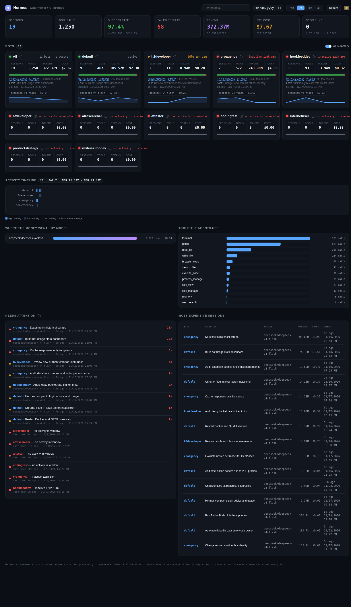

# Hermes Watchtower

A live, per-profile operations dashboard for Hermes agents — sessions, tool calls,
success/failure rates, token usage, and estimated cost, grouped by bot/profile.

Inspired by the Corda "Operate / Night shift" ops dashboard. Reads Hermes's own
SQLite session stores **read-only** and serves a self-contained web UI (no build
step, no dependencies, vanilla JS + inline SVG). Works with any Hermes install
(`$HERMES_HOME` aware) and any number of profiles/bots — nothing is hardcoded per bot.

This repository is also an installable **Hermes skill**: `SKILL.md` at the repo
root means Hermes users can install it with the skills installer, and agents
become aware of the dashboard (auto-load when asked about agent usage/stats).

---

## Features

**Per-bot cards** (one per profile, sorted active → idle → inactive, then cost):
- Sessions, tool calls, tokens (input+output+cache), estimated cost
- Success bar: green = success %, red = error %, solid gray when no activity
- Status: `active` / `idle Xh Ym` / `inactive Xh Ym` / `no activity in window`
- Last session title + last activity, model chips (top 3 by cost), activity sparkline
- **"All" card** (toggle on the heading, persisted in `localStorage`) — sums every
  bot as if it were one; its drill-down merges tool calls across bots
- **ⓘ button** on each card → skills & key files browser (left pane = scrollable
  file list, main area = file contents)
- **🔧 button** on each card → **actions modal** (maintenance actions for that bot).
  Its first action, **Audit Skills**, opens a list of **every** skill installed for
  the bot — generated **automatically when the dialog opens** (the button re-runs it,
  and changing the window selector re-runs it too): used rows are dimmed
  ("used 3d ago"), unused ones are flagged (never loaded, or not loaded within the
  selected window — **30 days / 90 days / forever**). Uses recorded
  `skill_view`/`skill_manage` results plus `skills/.usage.json` timestamps; each
  row shows last-used time and load count, and clicking a skill opens its SKILL.md.
  Unused rows are **multi-selectable** (with select-all); once anything is ticked
  a red **Delete Skills (N)** button appears and asks *"Are you sure you wish to
  delete these unused skills?"* — confirmed skills are moved to
  `~/.hermes/trash/watchtower-skills/<timestamp>/` (restorable, never hard-deleted).
  Used skills are listed but not selectable.

**KPI row**: sessions, tool calls, success rate, failed results, tokens, estimated
cost, cron runs — all scoped to the current time window.

**Activity timeline**: per-bot rows of colored cells (hourly for ≤2-day windows,
daily otherwise), intensity = session count.

**Cost by model** and **tool usage** breakdowns.

**Needs attention** (with ⓘ explainer): sessions with failed tool calls (red dot
= 5+ failures, amber = 1–4) and inactive bots (with last-seen context).

**Most expensive sessions** table.

**Tool-call modal** (click `%success` / `#failed` on any card):
- Scrollable, **sortable** table: Session, Tool, Summary, Datetime, Tok. sent,
  Tok. recv, Time, Model — failed rows highlighted
- **Session selector** (per-session filter) + **outcome filter** (All/Success/Failed)
- Summary line under the title: `N messages, M tool calls`
- Click a summary → full message viewer (pretty-printed JSON) with a **Copy** button

**Time windows**: 24h / 7d / 30d / all, plus a **date picker** anchoring the window
(a date D ⇒ 24h = the calendar day D, 7d/30d = that many days ending on D; no date
⇒ rolling window from now). Picking a date resets to 24h; clearing returns to live.

**Theme**: dark/light toggle (top-right), follows OS preference by default,
persisted in `localStorage` (`ho-theme`). No theme flash on reload.

---

## Install

**As a Hermes skill (recommended)** — the repo root *is* a skill (`SKILL.md`
teaches the agent how to run and maintain it) plus the app itself:

```bash
git clone https://github.com/<you>/hermes-watchtower.git
cd hermes-watchtower
./install.sh
```

`install.sh` copies the app to `~/.hermes/skills/hermes-watchtower/`, writes a
desktop menu entry, and prints the next steps. Options (`./install.sh --help`):

| Flag | Effect |
|---|---|
| `--skill-dir DIR` | copy target (default `~/.hermes/skills/hermes-watchtower`) |
| `--port N` | port baked into the launcher (default 8790) |
| `--no-skill` | don't copy — run the clone in place |
| `--no-desktop` | skip the menu entry |
| `--systemd` | also install + enable a systemd **user** service (always-on URL) |
| `--force` | overwrite an existing copy (upgrade) |

Then **restart your Hermes session** (the skill index is built at session
start). Any of these opens it:

| How | What happens |
|---|---|
| Chat: *"open the watchtower"* | the agent loads the skill and starts the server |
| App menu → **Hermes Watchtower** | `open.sh` starts the server if needed, opens the browser |
| `~/.hermes/skills/hermes-watchtower/open.sh` | same as the menu entry |
| `alias watchtower=~/.hermes/skills/hermes-watchtower/open.sh` | your own shortcut |

`open.sh [port]` is idempotent: it probes `/api/data`, starts the server only
if nothing answers (detached, logging to `server.log`), waits for it, prints the
URL and opens the browser (`$BROWSER`, `xdg-open`, `open`, or `wslview`).

**Just run it** (no skill install):

```bash
./start.sh                # foreground, default port 8790
./start.sh 9000           # custom port
python3 server.py --port 8790 --home ~/.hermes   # explicit options
```

Then open http://127.0.0.1:8790



- Auto-refreshes every 30 s
- Card data is loaded with the page (`/api/data`); the tool-call modal and full
  messages are fetched **on demand** when opened; an open modal does not live-update

### Restart (after server.py changes)

```bash
kill $(pgrep -f "^python3 server.py")   # anchored pattern — see Pitfalls
cd ~/hermes-watchtower && (nohup python3 server.py --port 8790 > server.log 2>&1 &)
```

Frontend edits (`index.html`) need no restart — it is read fresh on every request.

---

## Data sources (all read-only)

| What | Where |
|---|---|
| Sessions, tokens, cost, models | `~/.hermes/state.db` (default profile) + `~/.hermes/profiles/<name>/state.db` |
| Per-model usage | `session_model_usage` table |
| Tool results / success-failure | `messages` table (`role='tool'`) |
| Cron executions | `~/.hermes/profiles/<name>/cron/executions.db` (usually empty) |

- DBs open with `mode=ro` (safe alongside a live gateway — WAL).
- Cost is **estimated** (`estimated_cost_usd`); providers never report actual
  spend, so that is the honest number.
- `sessions` holds per-session token totals (input/output/cache_read/cache_write/
  reasoning) — there is **no per-call token accounting** (`messages.token_count`
  is NULL). Per-call token columns in the modal are **estimates = payload chars ÷ 4**
  and labeled as such.
- `messages.tool_call_id` matches the assistant call's `call_id`/`id`, so each
  call pairs exactly with its result (duration = result.ts − call.ts).

### Failure detection

A tool result is *failed* iff its content matches any of:

```
"success": false
"error": <non-null>
"status": "error"
EXIT_CODE=[1-9]
```

A naive `LIKE '%error%'` is ~40× too noisy (it matches `"error": null`, filenames,
etc.) — the markers above are deliberately conservative.

---

## HTTP API

All endpoints: `GET`, JSON, `Cache-Control: no-store`, bound to 127.0.0.1.

| Endpoint | Params | Returns |
|---|---|---|
| `/api/data` | `range` (1/2/7/30/0), `date` (YYYY-MM-DD, optional) | Aggregate payload: totals, per-profile stats, models, tools, timeline buckets, attention list, expensive sessions, window label |
| `/api/toolcalls` | `profile`, `range`, `date` | Per-call history (tool, summary, datetime, est. tokens, duration, model, failed, sid/call handles, session title, profile). `profile=all` merges every bot (session titles prefixed `bot · title`) |
| `/api/toolmessage` | `profile`, `sid`, `call` | Full raw content of one tool result (lazy, per-row) |
| `/api/profilefiles` | `profile` | Whitelisted key files: SOUL.md, config.yaml, profile.yaml, memories/*.md, skills/**/SKILL.md, plugins/*/plugin.yaml. `all` merges with bot prefixes |
| `/api/profilefile` | `profile`, `file` (rel path) | Text content of one whitelisted file (500 KB cap, binary refused) |
| `/api/skillsaudit` | `profile`, `days` (30/90/0 = forever) | Installed skills vs. recorded use: per skill `rel`, `name`, `last_used`, `count`, `unused`. `all` merges every bot (entries carry `profile`, `rel` prefixed) |
| `/api/skillsdelete` (POST) | JSON body `{items: [{profile, rel}]}`, header `X-Watchtower: delete` | Moves skill dirs to `~/.hermes/trash/watchtower-skills/<stamp>/`; returns `{count, deleted[], failed[], trash}` |

Window semantics: no `date` → rolling window ending now; `date=D` → window *ends*
on D (24h = D's calendar day, 7d/30d = N days ending on D, all = everything up to D).
Hourly timeline buckets for ≤2-day windows, daily otherwise.

## Configuration

Everything runs with sensible defaults; optional knobs:

| Setting | How | Default |
|---|---|---|
| Port | `--port N` / `start.sh N` | 8790 — if busy, the server **falls back to a free ephemeral port** and prints the real URL |
| Hermes home | `--home DIR` / `$HERMES_HOME` | `~/.hermes` |
| Failure markers | `HO_FAIL_MARKERS` (comma-separated kinds: `success_false`, `error_nonnull`, `status_error`, `exit_code`) | all four enabled |
| Extra failure markers | `HO_EXTRA_FAIL_MARKERS` (pipe-separated literal substrings) | none |
| Cost rates | `config.json` → `rates: {model: {input, output, cache_read, cache_write}}` (USD per 1M tokens) or `HO_RATES` (JSON) | none → use Hermes's stored `estimated_cost_usd` |
| Cost calibration | `config.json` → `cost_multiplier` or `HO_COST_MULTIPLIER` | 1.0 |

**Cost model**: by default the dashboard sums Hermes's stored `estimated_cost_usd`
(list price × tokens, recorded per session). If `rates` are configured for a model,
the dashboard **recomputes** that model's cost from the recorded token counts instead
(input, output+reasoning, cache read/write at your rates) — useful when the provider's
real price differs from what Hermes assumed. The footer shows which mode is active.
`cost_multiplier` then scales every displayed cost, for calibrating against your
provider's usage page. A `config.example.json` is included — copy it to `config.json`
(gitignored) and adjust rates for the models you actually use.

Note: this dashboard only sees **Hermes** usage. Provider balances (e.g. Kilo
credits) are often shared with other tools (IDE extension, CLI, cloud agents), so
the provider's usage page will usually show more spend than this dashboard does.

The failure-marker knobs exist because Hermes's tool-result JSON could change
across versions — if a new error shape appears, add it via `HO_EXTRA_FAIL_MARKERS`
(e.g. `'"ok": false'`) without touching code.

**Schema guard**: each profile DB's `schema_version` is reported in `/api/data`
(`schema.profiles`) and flagged as a mismatch when it differs from the supported
version (currently **33**). Mismatched profiles get a `schema_warning`; the rest
of the dashboard keeps working.

## Testing

```bash
python3 tests/test_aggregation.py    # 31 regression checks, stdlib only
```

Builds a synthetic Hermes home in a temp dir and asserts: aggregation totals,
failure detection (all marker kinds + the `error: null` negative case), tool-call
pairs/durations, the file-browser whitelist (`.env` and traversal rejected), the
`profile=all` merge, env-config parsing, and the schema guard.

## Security model

- Binds to **127.0.0.1 only**, no auth — do not expose publicly.
- DBs are opened read-only.
- The file browser is a strict **whitelist**: `.env`, `auth.json`, state DBs,
  caches, lock files, and transient runtime JSON are never listed or served;
  path traversal is rejected.
- File content is rendered as text (`textContent`), never injected as HTML.
- **One write action exists: skill deletion** (actions modal → Delete Skills).
  It is confirmed in a dialog, only accepts paths ending in `/SKILL.md` that
  resolve inside `<profile>/skills/`, refuses symlinks, and **moves** the
  directory to `~/.hermes/trash/watchtower-skills/<timestamp>/` — nothing is
  hard-deleted. The endpoint is `POST /api/skillsdelete` and requires an
  `X-Watchtower: delete` header, so a random web page cannot drive-by POST
  (a custom header forces a CORS preflight this server never answers).

---

## Frontend conventions

- Single `index.html`, vanilla JS + inline SVG, **zero dependencies**, up to 1600px wide.
- Prefs persisted in `localStorage`: `ho-theme`, `ho-all`. Applied in a head
  inline script before first paint (no flash).
- Modal stack: tool-call list (`#modal`) → full message (`#dmodal`, copy button)
  → info popover (`#imodal`) → profile files (`#pmodal`). All close on ✕, backdrop,
  Escape.
- Table dates use `YYYY-MM-DD HH:MM` (zero-padded), not locale strings.

---

## Repository layout

```
hermes-watchtower/
├── server.py            # stdlib HTTP server + aggregation (no third-party deps)
├── index.html           # the whole UI (CSS + JS inline)
├── start.sh             # foreground launcher
├── open.sh              # start-if-needed launcher: prints URL, opens the browser
├── install.sh           # Hermes-skill install + desktop entry (+ optional systemd)
├── README.md            # this file
├── SKILL.md             # Hermes skill wrapper — makes this repo installable as a skill
├── LICENSE              # MIT
├── config.example.json  # copy to config.json to override cost rates
├── tests/               # regression tests (fixture state.db, stdlib only)
├── docs/screenshot.png
└── references/          # optional skill reference files
```

The dashboard is a Hermes *plugin-free* app: it reads Hermes data but runs as a
standalone local web server, so it also works for people who don't use Hermes'
plugin system.

---

## Pitfalls & maintenance notes

- **Restarting the server**: never use an unanchored `pkill -f server.py` in the
  same command that also contains the string `server.py` (e.g. a nohup start) —
  the pattern matches your own shell's command line. Anchor `^python3 ` and kill
  the PID (`kill $(pgrep -f "^python3 server.py")`).
- **Query params**: `encodeURIComponent` turns `/` into `%2F`; the server URL-decodes
  with `urllib.parse.unquote` — keep that when changing param handling.
- **"Loading…" placeholders**: never overwrite a container that child elements
  must survive (it destroys them); put loading/error rows inside the tbody.
- **All-card drill-down**: synthetic cards carry a separate API key
  (`profile_key: "all"`) from their display name.
- **Verification**: after changes, verify via `curl` (API) and a real browser
  (UI) — reading the code is not verification.

## License

MIT
